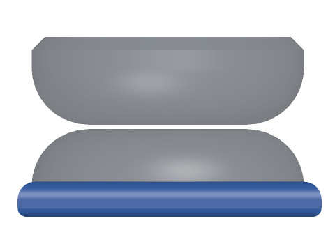
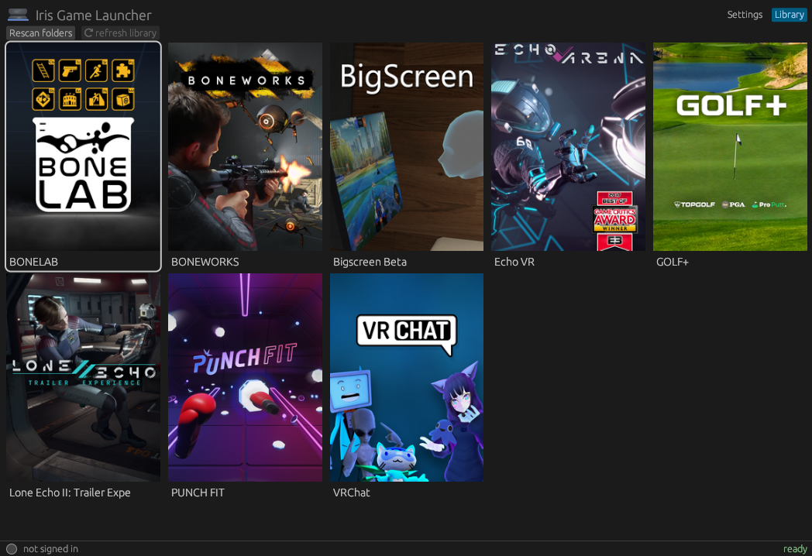

  
  <h1>Iris Game Launcher</h1>
  <h5>20 MiB file, 20 MiB VRAM, 90 MiB RAM, for the whole app.</h5>

A lightweight replacement for the Meta Quest Link App.
  
Play all your bought games on Linux and Windows.

<h5>Use your system resources for your games, not the launcher.</h5>

  

## Is this project SLOP?

While this project has been *vibecoded* (and I'm not proud of it), care has been taken to ensure this project is free of bugs, problems and regressions. 
This app has been rigorously tested by me, and I'm (mostly) confident of its quality.

This project has been made entirely using local, open-weight models run on my own modest hardware. 
No Claude or ChatGPT here.

## Install

- Linux: grab the AppImage from the [releases](https://github.com/michauMiau/iris-game-launcher/releases) page, `chmod +x IrisLauncher-x86_64.AppImage`, run it. Needs FUSE (or `--appimage-extract-and-run` if you don't have FUSE).
- Windows: grab `IrisLauncher-win-x86_64.exe` from the [releases](https://github.com/michauMiau/iris-game-launcher/releases) page and run it.

## Command line

`iris-launcher --help` lists the options; the full list with notes lives in
[docs/cli.md](docs/cli.md). Headless ones include `--launch <game>`, `rescan`,
`--download <id>`, `--reset-prefix` and the login handlers.

## Game Compatibility

| Game    | Status |
| :--------: | ------- |
| BONELAB  | ✅ Leaderboards and achievements not implemented, Fusion broken |
| BONEWORKS | ⚠️ Launches, but the headset view does not appear yet. Linux test pending; on Windows the game refuses to start. |
| [See More](docs/game-compatibility.md) |

## License

GPL-3.0. The OpenXR translation layer (Revive derivative) is MIT.
